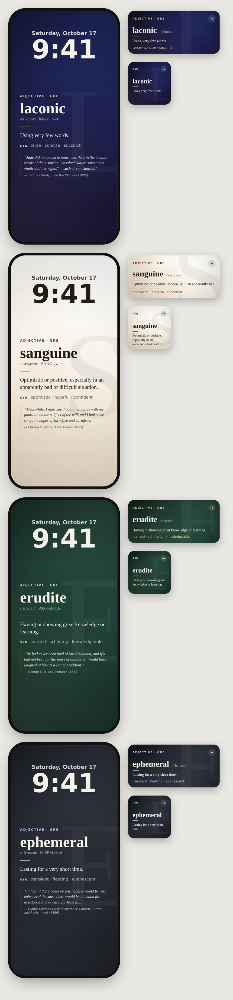

# GRE Vocab: a vocabulary "wallpaper" for iPhone

GRE Vocab puts a new GRE word in front of you every time you pick up your phone. Each word comes with:

- **Pronunciation**: IPA, an easy respelling (e.g. *luh-KON-ik*), and tap-to-hear audio. The headword is spoken from its IPA transcription, so the pronunciation matches the dictionary. It uses Apple's on-device voices, works offline, and still plays when the phone is on silent.
  For a natural, human-sounding voice, download a **Premium** or **Enhanced** English voice once (iPhone **Settings › Accessibility › Spoken Content › Voices › English**, e.g. *Ava*, *Zoe* or *Evan*). The app picks the best installed voice automatically, or you can choose one in **Settings › Pronunciation**.
- **Definition**, part of speech, **synonyms**, **antonyms** and **related words**. A synonym that is also in the word list links straight to its own card.
- **Origin and history** (etymology), when it helps the word stick.
- **Three real example sentences**, quoted word for word from literature, news and speeches, each with its author, source and year.

## Design

Four themes (**Midnight Ink**, **Ivory Paper**, **Library Green** and **Graphite**) style the word card, every widget size and the wallpaper. Each background is drawn in code: a deep base gradient, a soft light falling from the top corner, an oversized serif monogram of the word's first letter, fine paper grain and a gentle vignette. Type is set in Apple's New York serif, with small-caps labels and a gold or oxblood accent rule, in the manner of a well-made book jacket. Choose a theme in **Settings › Appearance**. When iOS tints widgets, they switch to plain system colors automatically.



*An HTML mock-up of the SwiftUI layouts (fonts differ slightly from iOS), not a device screenshot.*

## Why a widget and a Shortcut, not a "wallpaper app"?

iOS has no public API that lets an app change your wallpaper. GRE Vocab gets the same effect in two ways:

1. **Lock Screen and Home Screen widgets** (no setup needed). The word changes on its own on the schedule you choose in Settings: every 1, 3, 6 or 12 hours, or daily. The Home Screen widgets have a ➜ button to skip to the next word.
2. **A real wallpaper, set by a Shortcuts automation.** The app adds a Shortcuts action called **Get Vocabulary Wallpaper** that turns the current word into a full-screen image. It leaves room at the top for the clock. A one-time automation then applies that image as your wallpaper every day.

The app, the widgets and the wallpaper always show the **same** word. The word is worked out from the current time, so no syncing is needed.

### Setting up the automatic wallpaper

1. Open **Shortcuts › Automation › New Automation › Time of Day**. Pick a time (e.g. 7:00 AM), set it to **Daily**, and choose **Run Immediately**.
2. Add the action **Get Vocabulary Wallpaper** (search for "GRE Vocab"). You can optionally pick a theme.
3. Add **Set Wallpaper Photo** (called "Set Wallpaper" on older iOS versions), choose the Lock Screen, and give it the image from step 2.
4. Expand that action and turn **off** "Show Preview" and "Crop to Subject".
5. If you rotate words more than once a day, add one automation for each change time.

The **Wallpaper** tab in the app shows the same steps, a live preview, theme choices, *Save to Photos* and *Share*.

## Building it (requires a Mac)

1. Install Xcode 15 or newer and [XcodeGen](https://github.com/yonaskolb/XcodeGen):
   ```sh
   brew install xcodegen
   ```
2. Generate the project and open it:
   ```sh
   xcodegen generate
   open GREVocab.xcodeproj
   ```
3. In **Signing & Capabilities**, choose your Team for **both** the `GREVocab` and `GREVocabWidget` targets. A free Apple ID is enough to run it on your own iPhone. With a free account the app must be re-installed from Xcode every 7 days. You can also set `DEVELOPMENT_TEAM` in `project.yml`.
4. If Xcode says the bundle ID or App Group is already taken, replace `com.cemcan` with your own reverse-DNS prefix in these places:
   - `project.yml`: both bundle IDs and both `application-groups` entries
   - `GREVocab/Shared/Settings.swift`: `AppSettings.appGroup`

   Then run `xcodegen generate` again.
5. Build and run on an iPhone with iOS 17 or later. Then long-press the Lock Screen › **Customize** › **Add Widgets** › **GRE Vocab**.

## Project layout

```
project.yml                 XcodeGen spec (app + widget extension, App Group)
GREVocab/App/               SwiftUI app: Today, Browse, Wallpaper, Settings tabs,
                            speech, wallpaper rendering, App Intents / Shortcuts
GREVocab/Shared/            Code used by both the app and the widget: word model,
                            repository, settings (App Group), rotation, NextWordIntent
GREVocab/Shared/Resources/  words.json, the bundled word list
GREVocab/Widget/            WidgetKit extension (Lock Screen + Home Screen)
tools/                      Data pipeline that builds words.json
```

## Where the example sentences come from

Every example sentence is an **exact quote** from a real text, found by searching the source text itself. None are made up or paraphrased. The sources are:

- **Literature:** public-domain books from [Project Gutenberg](https://www.gutenberg.org/), via the GITenberg mirror and the NLTK Gutenberg selection.
- **News:** BBC News articles from 2004–05 (the Greene & Cunningham BBC dataset), the *Reuters-21578* newswire (Reuters, 1987) and Australian Broadcasting Corporation science and rural news (both via NLTK).
- **Speeches:** U.S. presidential inaugural addresses and State of the Union addresses, which are public records.

The definitions, synonyms, antonyms, related words, IPA and etymologies were written for GRE study.

## Regenerating or extending the word list

```sh
pip install pyyaml
tools/fetch_corpus.sh          # downloads ~70 public-domain books, Reuters and the speeches into tools/.corpus/
python3 tools/build_words.py   # writes GREVocab/Shared/Resources/words.json
python3 tools/build_words.py --report   # same, and prints every chosen quote for review
```

- `tools/words/*.yaml`: the word entries (definition, IPA, respelling, synonyms, antonyms, related words, etymology). Add a word here, listing its inflected `forms` so the search finds them. Use `exclude` to drop a quote you don't like, and `lowercase_only: true` for words that clash with proper nouns (*august*, *pacific*).
- `tools/sources.yaml`: the books, with author, year and translator. A `start` marker skips an editor's introduction or a translator's preface, so every quote is the author's own words.
- `tools/build_words.py`: picks three quotes from different sources for each word. It prefers a news quote, a literary passage and a speech (or a second news outlet), and falls back to whatever real sources use the word.

## Troubleshooting

- **"Personal team does not support App Groups."** Some free Apple IDs can't use App Groups. Remove the `entitlements` blocks from `project.yml` and regenerate. The widget still works, but the app's Settings (rotation interval, skipped words) won't reach it, so it falls back to one word per day.
- **The widget shows an old word.** iOS limits how often widgets refresh. Hourly rotation is best effort, and opening the app forces a refresh.
